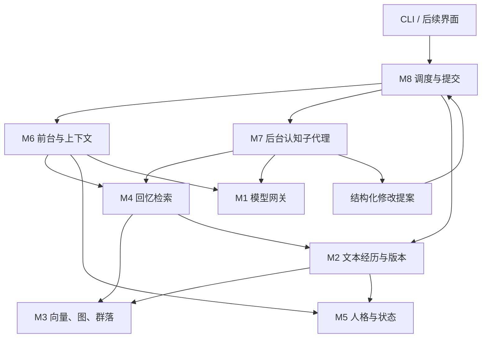

# MYATRI 动态记忆与人格演化 Agent 工程规划书

2026-10-20 持久运行修复：0.1.1 已修复重复压缩、索引快照/发布/历史证据、后台有界材料、调度/时间及共享预算，并接通日常表达/反馈归因。178项完整离线回归通过，详见[修复与边界](../reports/persistence_fixes_2026-10-20.md)。本轮0次新API，长期语义及实体/技能设计仍待验证/实现。下文旧审查状态为历史记录，以本补记为准。

版本：0.3（保留0.2架构与来源锁定）；初稿：2026-10-19；修订：2026-10-20；用户时区：Asia/Shanghai。

本次修订：补充动态人物/项目/地点入口、技能学习记忆与Embedding的实际实现边界。稳定实体与技能入口仍属待实现设计；默认TF-IDF、可选本地BGE、多视角、全量重建等按源码说明。保留0.2的统一临时状态、局部人格演化与来源约束。详细讨论稿和可勾选检查表见[动态索引与技能记忆设计](04_动态索引与技能记忆设计.md)。本轮只更新文档。

状态：V1八模块已有本地实现；最新普通回归116项通过，LLM压缩/激活有2次新增短live验证，但完整V1验收因已知一致性与行动反馈缺口仍开放。本文同时包含现状与目标；没有明确实现证据的目标不能当作已交付。历史80项、13次live记录保留，最新状态见[STATUS](progress/STATUS.md)及[组件审查](../reports/component_review.md)。

## 0. 给接手 Agent 的执行摘要

### 0.1 要交付什么

构建一个通过外部 DeepSeek API 运行的持久角色系统。前台与用户交互；后台由多个认知子代理整理经历、解释记忆关联、形成主题、反思并提出人格修订。经历使用可读文本保存，并通过多维 Embedding、相似图、语义关系和动态群落建立索引。人格可以变化，但每次只做有依据的小范围修订，并能回忆变化的经过。

第一版交付完整闭环：聊天 → 经历落盘 → 向量关联 → 聚类主题 → 回忆 → 临时状态产生与激活 → 行为尝试或暂缓 → 反馈与反思 → 调整/放弃或持久人格修订 → 上下文重建 → 重启恢复。临时状态可以停留、消退或放弃，不强制流向人格更新。

上述是交付目标。当前普通聊天尚未自动接通实际行动/反馈归因；稳定人物索引和技能学习入口也未完成。动态组织采用两层互联：实体/技能入口维持身份与相关经历，主题层随材料形成、拆分或合并；相似聚类不承担身份判定或技能掌握判定。

### 0.2 不要误读为这些目标

- 不是训练一个新的基础模型；DeepSeek 是可替换的推理服务。
- 不通过增加子代理数量来代替清晰的输入、输出、来源和提交协议。
- 不以固定次数直接推导人格变化；次数、时间、图变化只是候选线索。
- 不把反思、模型推理文本或重复提及，伪造为新的外部经历。
- 不在第一版训练 GNN，也不同时部署 A-MEM、Ashley、GraphRAG、Graphiti 四套完整系统。
- 第一版可以形成“想找某人聊聊”的内部意图或草稿，但默认不主动向真实用户或其他联系人发送消息，不自主联网活动，不操作外部账户。主动交流扩展见第 10.5 节和可选任务 E01；讨论能力或修订文档不等于启用发送。

### 0.3 默认工程路线

采用 Python 3.12、asyncio、自定义轻量任务运行器、SQLite 运行数据库、版本化 Markdown/JSON 文本档案。用可替换的向量索引和聚类后端实现记忆网络。先建立精确向量检索基线，再按规模引入 ANN 后端。默认单角色、单用户、单机运行，标识字段保留隔离能力。

本机Python/Windows、本地TF-IDF/BGE与Leiden已有运行证据；新机器仍应按T00/T01与恢复手册检查环境。不兼容时在同一接口内替换，并记录ADR。新实体/技能方案没有因旧基线测试通过而自动获验收。

八个业务模块：M1 模型网关；M2 经历与版本存储；M3 语义索引与记忆图；M4 回忆检索；M5 人格与当前状态；M6 前台与上下文管理；M7 认知子代理；M8 运行调度与统一提交。

## 1. 需求依据、默认选择与待确认项

### 1.1 用户已明确提出的要求

| 编号 | 要求 | 在本方案中的位置 |
|---|---|---|
| R01 | 外部 API，当前倾向 DeepSeek，Agent 深度定制 | M1、M6、M7 |
| R02 | 文本经历，按日期、事件、人物、情感等索引 | M2、M3、M4 |
| R03 | 每条经历计算多维向量，自动聚类形成索引与图 | M3 的相似图、群落和主题层 |
| R04 | 按关联临时读取原文，形成回忆 | M4 |
| R05 | 自动压缩，保留手动压缩；优先保留重要近期内容 | M6 |
| R06 | 经历可以通过大模型语义判断改写核心人格 prompt | M5、M7 |
| R07 | 临时积累 → 最近感觉到…… → 持久小范围人格更新 | M5、M7；语义判断决定是否更新 |
| R08 | 人格修改经过进入经历库与上下文，可被回忆 | M2、M5、M6 |
| R09 | 大部分内容理解、反思、修订工作由认知子代理承担 | M7 |
| R10 | 两三个小时、夜间、长时间空闲等低频触发 | M8 |
| R11 | 少用机械规则，允许动态关联和自然语言状态 | 图与模型主导内容判断，程序保障完整性 |
| R12 | 临时起意、萦绕的感受、未决想法可以灵活进入上下文 | M5 临时状态池、M6 按情境激活、M7 的 A8 |
| R13 | 先产生暂定倾向，经尝试/观察后决定维持、调整或放弃 | 第 9.5–9.8 节；不以内部反思冒充实践反馈 |
| R14 | 遇到新人或新项目/地点后建立稳定入口，持续关联后续经历 | 第6.7节；04设计稿DMI-01/02，尚未实现 |
| R15 | 学习新技能时建立学习入口，组织材料、步骤、尝试与反馈 | 第6.8节；04设计稿DMI-03/04，尚未实现；总结不等于掌握 |

### 1.2 本规划给出的默认选择

- Python 定制底座，不完整 fork 任何一个参考系统。
- 文本档案是经历和状态版本的权威记录；SQLite 是运行状态、检索投影和任务队列。
- 先做纯文本 CLI；检查界面仅需能查看记忆、关系、群落、人格差异和任务轨迹。
- 事件单视角作为对照基线；现已提供事件/感受等分视角索引及本地对照实验，保留多视角未稳定提升的负结果。后续新增实体/技能视角仍需独立对照。
- kNN 相似图 + Leiden 群落为聚类默认候选；不预设主题总数，不给每条记忆强制唯一语义归属。
- 相似边参与基本聚类；支持、反驳、因果假设等保持类型，不直接混成同一种正权边。
- 前后台共享模型网关，但前台与后台使用独立任务、上下文和并发额度。
- 主要语义更新允许自动提交，不要求用户逐条审批；程序检查版本与证据，必要时由审阅子代理检查。

### 1.3 后续可以调整、但不阻塞离线工程的选项

DeepSeek 具体模型和每日预算；Embedding 服务或本地模型；初始角色卡；实际运行时段；是否需要图形界面；是否最终扩展自主阅读、主动联系和外部操作。

公开配置默认关闭付费调用，运行命令显式区分离线fixture与live。本机凭据存在Windows凭据管理器，不写入项目文件；官方短live验证与离线结构验证分开记录，未填key仍可完成独立离线工作。

## 2. 借鉴项目：精确来源与采用方式

核查的是源码与官方文档，不是只依据 README 的功能宣称。锁定信息见 `03_参考源码锁定.json`。A-MEM 与 Ashley 已读主要源码；GraphRAG 与 Graphiti 已读本节列出的聚类/报告、节点/边/检索源码。本次没有运行这些项目或验证它们所有分支。

### 2.1 A-MEM：动态关联记忆组件

仓库：[agiresearch/A-mem](https://github.com/agiresearch/A-mem)，MIT；提交 `ceffb860f0712bbae97b184d440df62bc910ca8d`。

| 源码 | 已观察到的方法/模块 | 采用方式 | 必须改造的地方 |
|---|---|---|---|
| [memory_system.py](https://github.com/agiresearch/A-mem/blob/ceffb860f0712bbae97b184d440df62bc910ca8d/agentic_memory/memory_system.py) | `MemoryNote`、`add_note`、`process_memory`、`search_agentic` | 借鉴笔记字段、近邻召回后交由模型建立联系 | 区分原始事件与解释；用稳定 ID 和版本；独立提交接口 |
| [retrievers.py](https://github.com/agiresearch/A-mem/blob/ceffb860f0712bbae97b184d440df62bc910ca8d/agentic_memory/retrievers.py) | Sentence Transformer + ChromaRetriever，另有 PersistentChromaRetriever | 借鉴检索器接口，按需移植小型封装 | 默认系统初始化会尝试 reset；不可照搬为长期存储 |
| [llm_controller.py](https://github.com/agiresearch/A-mem/blob/ceffb860f0712bbae97b184d440df62bc910ca8d/agentic_memory/llm_controller.py) | 生成后端封装、结构化结果 | 参考调用分层 | 添加 DeepSeek 能力适配、校验、重试、用量与协议保存 |

源码限制：`analyze_content()` 虽存在，但已读 `add_note()` 没有自动调用它，不假设新笔记必然完整提取元数据；核心实现无独立聚类/GNN/完整图引擎。邻居位置与稳定 ID、结果截断、内存对象与向量元数据同步必须在借用前重审。先复现实验，再决定是否拷贝。

### 2.2 Ashley：常驻角色与反思运行方式

仓库：[alpaim/ashley](https://github.com/alpaim/ashley)，MIT；提交 `c2e0c0b5563773c80a5d2acc0c5fb007c04e4212`。

| 源码 | 已观察到的方法/模块 | 采用方式 | 必须改造的地方 |
|---|---|---|---|
| [runner.rs](https://github.com/alpaim/ashley/blob/c2e0c0b5563773c80a5d2acc0c5fb007c04e4212/src/runner.rs) | 消息、heartbeat、会话超时、收尾、状态保存 | 借鉴触发类别和生命周期；Python 重写 | 分支内 await 长任务会推迟主循环；改为持久队列 worker |
| [agent.rs](https://github.com/alpaim/ashley/blob/c2e0c0b5563773c80a5d2acc0c5fb007c04e4212/src/agent.rs) | 人格/情绪/记忆/历史组装、工具循环 | 借鉴上下文分层与工具往返 | 重写 token 预算、工具协议与快照一致性，不复制全部产品设定 |
| [memory/search.rs](https://github.com/alpaim/ashley/blob/c2e0c0b5563773c80a5d2acc0c5fb007c04e4212/src/memory/search.rs) | 向量候选、重要性/近期/回忆频率重排 | 作为比较基线 | 不沿用固定权重作为人格或回忆真理；引入图关系、来源与反例 |
| [heartbeat/mod.rs](https://github.com/alpaim/ashley/blob/c2e0c0b5563773c80a5d2acc0c5fb007c04e4212/src/heartbeat/mod.rs)、[heartbeat/multi_loop.rs](https://github.com/alpaim/ashley/blob/c2e0c0b5563773c80a5d2acc0c5fb007c04e4212/src/heartbeat/multi_loop.rs) | 空闲/睡眠窗口、不同反思路线、分阶段分析 | 借鉴认知任务分解 | 不硬编码“四小时”及原项目情绪/关系假设；修正时区与调度语义 |
| [identity_evolution/engine.rs](https://github.com/alpaim/ashley/blob/c2e0c0b5563773c80a5d2acc0c5fb007c04e4212/src/identity_evolution/engine.rs) | 分析变化、修改 SOUL 分节、写演化记录 | 借鉴提案—应用—记录流程 | 统一局部 patch、证据、冲突处理与上下文失效 |
| [workspace.rs](https://github.com/alpaim/ashley/blob/c2e0c0b5563773c80a5d2acc0c5fb007c04e4212/src/workspace.rs) | 文本工作区、临时文件后 rename | 借鉴原子写入思路 | 扩展多文件提交与崩溃恢复；不能把一次 rename 当作跨库事务 |

Ashley 是 Rust 实验项目；我们采用 Python，所以主要借鉴组织方式、数据边界与方法，不把它的 Rust 代码算作直接复用。不同认知流程不等于独立常驻人格。

### 2.3 GraphRAG：群落与分层摘要

仓库：[microsoft/graphrag](https://github.com/microsoft/graphrag)，MIT；提交 `5faaaf4f5685fa2056fa8c3bf9342cb089f2942f`。

- [cluster_graph.py](https://github.com/microsoft/graphrag/blob/5faaaf4f5685fa2056fa8c3bf9342cb089f2942f/packages/graphrag/graphrag/index/operations/cluster_graph.py)：边表 → hierarchical Leiden → 层次及父子群落。
- [create_community_reports.py](https://github.com/microsoft/graphrag/blob/5faaaf4f5685fa2056fa8c3bf9342cb089f2942f/packages/graphrag/graphrag/index/workflows/create_community_reports.py)：群落材料组织和报告生成。
- [官方数据流](https://microsoft.github.io/graphrag/index/default_dataflow/)：标准实现先抽取实体关系图，再做社区发现。

我们参考其层次结构和“群落 → 模型摘要”的方法；主图改成事件向量近邻图。不直接引入它的完整 pandas/配置/模型/存储流水线。Leiden 的单次分区不天然重叠，我们另存软主题归属，不能宣称 Leiden 原生提供重叠群落。

### 2.4 Graphiti：时间与证据、混合检索

仓库：[getzep/graphiti](https://github.com/getzep/graphiti)，Apache-2.0；提交 `7b0182f94d27075db488636cd5456981ee10b987`。

- [nodes.py](https://github.com/getzep/graphiti/blob/7b0182f94d27075db488636cd5456981ee10b987/graphiti_core/nodes.py)：`EpisodicNode` 保存内容与时间，实体摘要与来源联系。
- [edges.py](https://github.com/getzep/graphiti/blob/7b0182f94d27075db488636cd5456981ee10b987/graphiti_core/edges.py)：边关联 episodes，带有效时间等字段。
- [search/search.py](https://github.com/getzep/graphiti/blob/7b0182f94d27075db488636cd5456981ee10b987/graphiti_core/search/search.py)：语义、全文、图遍历及 RRF/MMR 等重排组合。

借鉴时间有效性、来源追踪和混合检索方法；第一版不依赖它的图数据库运行栈。把角色推断存为 hypothesis，而不是借用了事实图字段就称其为事实。

### 2.5 Thoughtful Agents：念头池与情境激活

仓库：[xybruceliu/thoughtful-agents](https://github.com/xybruceliu/thoughtful-agents)，Apache-2.0；提交 `4c8d5beb249f852465463ed236fbbff95e0b6b0d`。

| 源码 | 已读实现 | 采用方式与差异 |
|---|---|---|
| [thought.py](https://github.com/xybruceliu/thoughtful-agents/blob/4c8d5beb249f852465463ed236fbbff95e0b6b0d/thoughtful_agents/models/thought.py) | Thought 保存内容、触发材料、表达动机及 selected；ThoughtReservoir 提供 add/remove/top-k | 借鉴念头与长期记忆分离、候选池选择；我们持久化并支持撤回、反馈和人格关联 |
| [mental_object.py](https://github.com/xybruceliu/thoughtful-agents/blob/4c8d5beb249f852465463ed236fbbff95e0b6b0d/thoughtful_agents/models/mental_object.py) | content、embedding、weight、saliency、产生/访问轮次 | 借鉴语义表示与当前显著性分开；构造时同步 Embedding 的方式不照搬，改为网关异步任务 |
| [saliency.py](https://github.com/xybruceliu/thoughtful-agents/blob/4c8d5beb249f852465463ed236fbbff95e0b6b0d/thoughtful_agents/utils/saliency.py) | 当前话语/解释与条目向量相似度、权重及轮次衰减参数 | 借鉴按情境重新激活；默认 decay_factor=1 不产生衰减，不能宣传为自动遗忘机制 |

该项目主要处理对话参与和何时表达，已读念头池是内存列表；不能视为已经提供持久的“临时倾向 → 实践 → 反馈 → 放弃/人格”系统。selected 仅指被选作表达，不证明行为已经发生。其论文：[Proactive Conversational Agents with Inner Thoughts](https://arxiv.org/abs/2501.00383)。论文背景参考不代表已逐项复现。

Ashley 的补充参考：[emotional/echo.rs](https://github.com/alpaim/ashley/blob/c2e0c0b5563773c80a5d2acc0c5fb007c04e4212/src/emotional/echo.rs)。已读 EmotionalEcho、process_echoes_during_idle、build_echo_context 和解决条件：保存未解决的情感余波，空闲再处理，并注入后续对话。我们采用内容池与上下文入口，不照搬按年龄/处理次数自动标记 resolved 的策略；达到时限只意味着应复查或降低激活优先级，不能证明角色已经放下。

### 2.6 复用规则

上述“拟借鉴”不代表整套代码已移植。0.1.2 已完成两处行为兼容的小型改编：A-MEM 的关联邻居去重/限量展开内核，以及 Letta Code 的原子快照写入内核，均接入生产路径。精确来源、原许可证、改动原因和验证见 `LICENSES/upstream/manifest.json`、`reports/upstream_reuse_2026-10-20.md`。后续复制或改写仍逐段登记并保留版权/许可证；Apache 来源同时检查 NOTICE。依赖许可单独登记，不能从上层项目许可推断。

Letta 当前实现位于 `letta-ai/letta-code`，旧 Python 服务保留在 `letta-ai/letta` 的 archive 分支。本版只改编当前实现的通用文件写入内核，未接入 Letta 运行时、MemFS 或 Dreaming。MIRIX、LangGraph 仍为替代路线背景。不能把这些框架的完整能力算作本项目已实现能力。

## 3. 我们独特的组合方法

这里的“独特”是本项目的定制组合与工程要求，不宣称学术首创，也不把向量检索、Leiden、GraphRAG 或反思本身说成原创。

| 方法 | 具体内容 | 与借鉴项目的区别 |
|---|---|---|
| U01 事件与解释双轨 | 原始经历稳定；后来理解以新版本附加 | 防止整理记忆时改写经历本身 |
| U02 多视角双层记忆图 | 事件/感受向量提供候选；模型解释支持、反驳、后续等语义边 | 向量相似不直接等同关系或证据 |
| U03 动态主题索引 | 群落自组织、主题命名、软归属、分裂合并与谱系 | 事件优先，不是固定分类或仅实体图 |
| U04 图驱动渐进人格 | 子图模式 → 暂定近期感受 → 有反例检查的局部人格修订 | 多次触发仅是线索，变化主要由语义判断决定 |
| U05 人格变化可回忆 | 修订是独立记录，链接事件、反思、前后人格；检索能回查 | 修改记录不只是开发日志，并且不会重复成为事件证据 |
| U06 前后台一致性 | 子代理在快照上提交提案；单写入器验证版本后提交 | 不允许多个模型随意覆盖共享人格文本 |
| U07 可解释回忆与压缩 | 保存召回路径、来源、摘要入口与人格版本，压缩后能恢复细节 | 退出上下文不等于永久删除 |
| U08 临时状态与实践反馈 | 念头/余波/暂定意图持久保存，按情境激活；表达、实践和放弃分开记录 | 临时状态不等于人格，也不因入选上下文就视为实践或巩固 |

## 4. 总体系统与八模块契约



### M1 模型网关 `providers/`

接口：`ChatProvider.generate(request) -> ModelResponse`；`EmbeddingProvider.embed(texts, space_id) -> EmbeddingBatch`。

- 请求携带 role、prompt_version、用途、输出 schema、工具定义、超时、预算与 trace_id。
- 返回 content、tool_calls、usage、finish_reason、provider/model、协议需要的 provider_fields；密钥仅从环境或本地密钥配置读取，不写入经历和日志。
- Chat 与 Embedding 分开配置；不能假设 DeepSeek 同时提供所需 Embedding 服务。
- 保存工具往返完整关联；参数由程序验证。模型工具能力、JSON schema 与 thinking 组合经 live smoke 后启用。
- DeepSeek 是无状态接口；客户端组织历史。思考模式携带 tools 时当前官方要求回传相应 reasoning_content，适配层保留，不把该字段当作角色经历或反思。
- 不在未完成工具往返中任意压缩协议历史；在完整边界重建新请求，并重新验证协议。
- 明确区分网络错误可重试、结构错误有限修复、预算不足延期；不把失败时空数组伪装成成功分析。
- 响应截断先识别，再修复或重试，不提交半份 JSON。
- 前台与后台分别限制并发；后台限流不占满前台额度。

参考：[DeepSeek 多轮对话](https://api-docs.deepseek.com/guides/multi_round_chat/)、[思考模式](https://api-docs.deepseek.com/guides/thinking_mode/)、[工具调用](https://api-docs.deepseek.com/guides/tool_calls/)。模型名、上下文上限和计价在实施时再次核查并写入配置，本文不锁死易变化的产品参数。

### M2 经历与版本存储 `storage/`

接口：`get_record(id, revision?, snapshot?)`、`append_message()`、`commit(proposal)`、`rebuild_projection()`、`verify_archive()`。

文本档案为权威：原始消息用不可变 JSON 记录；经历、解释、主题、人格版本用带 schema 元数据的 Markdown 文档；提交 manifest 引用所有变更文件及校验和。JSON 本身也属于文本档案。

SQLite 保存规范化投影、FTS5、向量位置、边、群落成员和运行队列；删除检索投影不能删除原始档案。任务队列是运行状态，单独备份，不承诺仅凭记忆文件恢复任意进行中的网络请求。

人工编辑通过 `memory edit/import` 产生新 revision，不直接覆盖已经提交的版本。当前人格卡是派生可读文件，手改后需显式导入；启动时发现不一致必须报告，不悄悄覆盖。

### M3 语义索引与记忆图 `memory/`

接口：`embed_revision()`、`upsert_similarity_edges()`、`apply_semantic_edges()`、`cluster(snapshot)`、`get_subgraph()`、`publish_index_generation()`。

包括可替换的 Embedding 缓存、精确/ANN 索引、相似图、语义图、社区发现、主题谱系。所有结果指向确切记录 revision。索引落后时状态可见，不能声称新记录已参与完整语义搜索。

### M4 回忆检索 `retrieval/`

接口：`recall(query, intent, filters, snapshot, budget) -> RecallBundle`。

返回事件、主题、解释、原文片段、召回原因与图路径，以及未检索到/索引滞后的信息。支持精确日期/人物、语义入口、主题入口、历史人格和反例检索。召回只激活材料，不直接决定当前态度。

### M5 人格与当前状态 `persona/`

接口：`read_state(snapshot)`、`validate_persona_patch()`、`upsert_temporary_entry()`、`select_active_entries(context, budget)`、`review_temporary_entry()`、`record_attempt_feedback()`。

分开保存核心人格、临时状态池、关系认识、关注点、未完成事项。近期感受是临时状态的一种视图；ThoughtReservoir 与 Emotional Echo 在本系统中以统一 TemporaryEntry 契约管理。保留 apply_recent_feeling/expire_or_revise_feeling 的兼容包装即可，不另建互不关联的感受库。人格使用稳定条目 ID 的 Markdown；更新作用于条目，不依靠模糊全文替换。运行规则不放入可随经历改写的人格区。

临时状态正文使用自然语言，允许感受、冲动、疑问、猜测、暂定尝试并存；管理元数据只控制来源、范围、版本和生命周期，不把角色心理强行量化成固定属性表。完整方法见第 9.5–9.8 节。

### M6 前台与上下文 `conversation/`

接口：`respond(turn)`、`build_context()`、`compact(mode, preserve_ids)`、`explain_context()`。

负责前台工具循环和上下文组装。输入包括当前人格、近期状态、未完成事项、相关记忆与历史摘要。TokenBudget 必须涵盖系统文本、工具 schema、协议字段、工具输出和输出预留；优先用提供方可用计数或经实际 usage 校准的估计器，中文不能简单按英文字符规则估算。

临时状态通过 select_active_entries 按话题、对象、语义关联和预算选择，单独标注“暂定、可采用或放弃”，不能作为强制命令。每次组装替换活跃区，不在历史末尾无限追加；撤回条目下一轮失效，旧摘要中的相应状态也须修订或明确过时。

### M7 认知子代理 `cognition/`

所有子代理只用工具读快照与提交提案；禁止直接修改档案、数据库或核心 prompt 文件。具体角色见第 8 节。复杂语义由模型完成，聚类与提交一致性由算法/程序完成。

### M8 调度与统一提交 `runtime/`

接口：`enqueue()`、`lease_job()`、`run_job()`、`submit_proposal()`、`commit_if_current()`、`recover()`。

使用持久队列、任务幂等键、租约、前后台优先级和单写入器。计划触发与是否值得反思分开。定期任务不能让 API 无限制自循环；全链路记录用量与结果，但不把 log 当经历来源。

## 5. 数据契约与权威记录

### 5.1 通用记录字段

```text
record_id, revision, schema_version, record_kind
agent_id, user_id, created_at, author_kind
source_refs[], supersedes_revision?, content_hash
generator: {provider, model, prompt_version, run_id} 或 human_import
body_markdown / structured_payload
```

`record_kind`：raw_message、event、interpretation、reflection、theme、temporary_state、behavior_attempt、persona_version、persona_change、attention_item。recent_feeling 作为 temporary_state 的兼容类型/视图，不维护两个独立权威版本。推理协议文本不是这些类型。

时间存 ISO 8601 UTC，显示与日程使用 Asia/Shanghai；事件发生时间与记录时间分开。未知日期保存范围/精度/未知，不自动填为当天。话语中“去年”按该消息时间解析。

### 5.2 主要对象

| 对象 | 必需字段与语义 |
|---|---|
| Event | event_id、occurred_at/range、recorded_at、participants、fact_summary、source_spans、event_fingerprint、reality_scope |
| Interpretation | event_refs、viewpoint、interpretation_text、uncertainty、valid_from/to、supersedes；不替换 event |
| Embedding | object_id/revision、view、model/revision、dimension、normalization、space_id、text_hash、vector_ref、status |
| Edge | edge_id、from/to 的 ID 与 revision、type、direction、weight、evidence_refs、status、valid_from/to、generator |
| ClusterSnapshot | cluster_run_id、graph_generation、algorithm/version/params/seed、members、parent、lineage、quality |
| Theme | theme_id/revision、cluster_refs、label、summary、support_refs、counter_refs、status、membership_weights |
| Reflection | question、selected_subgraph、snapshot_id、claims、evidence_refs、counter_refs、uncertainties、attention_updates |
| TemporaryEntry | text、kind_hint、scope、origin_refs、origin_kind、tentative、status、review_at、last_relevant_at、generator、prior_revision；kind_hint 可扩展 |
| ActivationSnapshot | entry_id/revision、context_snapshot、saliency_components、reason、selected；是当前激活投影，不是角色人格或事实概率 |
| BehaviorAttempt | intent_ref、decision_status、action_refs、occurred_at、observed_feedback_refs、outcome_unknown；无行动来源不能标记已实践 |
| RecentFeeling（兼容视图） | 指向 TemporaryEntry，不另存一份可冲突的正文；support_refs/counter_refs 映射到来源与反例关系 |
| PersonaChange | change_id、target_entry_ids、old_hash、proposed_text、reason、event_roots、reflection_refs、counter_refs、scope、base_version、result_version |
| AttentionItem | topic、reason、origin_refs、next_review、status；不是强制对用户提问或发送消息 |
| Proposal | proposal_id、idempotency_key、base_snapshot、read_set、operations、evidence_refs、prompt_version、run_id |
| Job | job_id、role、trigger、input_watermark、dedup_key、priority、status、lease_until、attempt、budget、result_proposal_id |

`reality_scope` 区分实际交互、转述、假设/虚构、角色自己的输出。原始消息证明“某句话说过”，不自动证明句中外部事件为真。对话引用、小说情节不得误计为用户真实经历。

### 5.3 图节点与边

目标节点：Event、Interpretation、Theme、Reflection、TemporaryEntry、BehaviorAttempt、PersonaEntry/PersonaVersion、PersonaChange、Entity（人物/项目/地点等）及Skill。Entity/Skill及其关联契约尚未加入生产代码；现有人物保存为Event.participants字符串，当前聚类图以事件为节点。详见04设计稿，不得把目标节点列表当成已实现schema。

边类型：similar_to、interprets、mentions、follows_up、member_of、supports、contradicts、reinterprets、derived_from、changed_by、causal_hypothesis，以及临时状态的 evoked_by、revises、attempts、feedback_for。ActivationSnapshot 不计为独立经历。

- 相似不代表支持；contradicts 不当作负数距离直接喂给默认 Leiden。
- 因果只能作为假设，除非原始材料足以支持该判断。
- derived_from 必须可追到原始来源；防止循环引用，让人格更新证明自己。
- 独立性按底层事件来源计算，不按引用条数、反思次数或图节点数计算。
- 别名/重复事件归并通过 canonical_event_id；有歧义先保留 distinct/pending，不误合并。

### 5.4 文件布局

```text
MYATRI/
  pyproject.toml                  # 已有依赖定义；uv.lock锁定实际解析版本
  src/myatri/
    providers/ storage/ memory/ retrieval/
    persona/ conversation/ cognition/ runtime/ interfaces/
  prompts/<role>/<version>.md
  config/defaults.toml            # 不含密钥；配置可迁移
  var/<运行库>/
    runtime.sqlite3               # 任务/用量/必要协议；不是纯派生索引
    domains/<agent-user-hash>/
      records/<id-hash>/<revision>-<content-hash>.json
      commits/<sequence>-<id>.json # 发布manifest
      projection.sqlite3          # 可重建检索投影
      indexes/current.json
      indexes/generations/<generation>.json
  tests/fixtures/ tests/integration/ tests/scenarios/
  evals/ reports/ docs/ LICENSES/
```

以上为当前主要布局，--root可指定其他目录。body_markdown保存在JSON记录内，不另维护可手改的当前人格MD副本。运行数据和密钥不进入Git；初始角色模板与合成fixture可以版本管理。不同agent/user检索和提交须强制隔离，不只靠prompt。

### 5.5 单写入与跨文件恢复

1. 子代理提交 Proposal；写入器校验 schema、读集版本、证据和幂等键。
2. 在同一磁盘生成新的不可变 revision 文件，写完并计算校验和；未被提交 manifest 引用的文件不可见。
3. 单写入器分配递增 commit sequence；写临时 manifest，flush 后原子发布为正式 manifest。manifest 是提交完成标记，包含所有文件和操作、父提交、预期旧版本。
4. 用一个 SQLite 事务应用该 manifest 的全部规范化投影，记录 applied_sequence；派生当前人格视图随后生成。
5. 异步索引任务按 revision 更新，发布独立 index_generation；不能在文件只写了一半时修改当前索引。
6. 崩溃发生在 manifest 前：孤儿文件忽略，后续清理。发生在 manifest 后：重放未应用 manifest。重放同一 commit 不重复修改。
7. 上下文使用 applied_sequence 对应的快照。所有读取受快照过滤；索引有自己的水位，较新数据通过精确/全文补查或明确标为未索引。已经生成回复不在后台人格更新后强制重写，下一轮读取新快照。

Windows 文件 replace、锁、SQLite WAL、重启与故障点需要真实文件系统集成测试。此设计不宣称目录 rename 等于跨文件/SQLite 原子事务；一致性来自不可变文件、发布标记和可重放投影。

## 6. 记忆、向量、聚类、主题：完整方法

### 6.1 写入与事件整理

新消息先落原始档案，再生成前台回复；会话末尾或材料累积后交给经历子代理。它输出事实摘要、解释候选、参与者、时间、来源片段和未确定项。程序验证引用确实存在。

同一原始事件被重复提及只增加 mention 关系；原约定、实际取消和后来重约可以是不同事件，通过 follows_up 相连。未履行约定尚无证据时不要凭时间自动生成“对方故意失约”。

### 6.2 向量表示

- 已实现可替换provider：默认字符1–4 gram TF-IDF（真实词面算法，维度随拟合语料变化）；可选固定revision的中文BGE-small-zh-v1.5，ONNX INT8/CPU、CLS池化、512维、L2归一化。BGE已下载和运行，不代表所有会话自动启用；DeepSeek聊天API不承担当前Embedding计算。
- 已实现event、feeling、theme、temporary_state分视角索引；event视角还编码部分原文/解释/反思/人格变更/会话摘要。感受仅在记录存在对应内容时编码；单事件来源的感受可anchor回该事件。反思不因此成为新的外部事件。
- 向量行绑定精确记录revision及模型/空间元信息；缓存按text_hash、view、模型/revision、dimension、normalization与space_id复用，不把record_id/revision作为缓存键；同文不同记录仍分别保留来源。不同空间不能直接算余弦，即使维度相同。TF-IDF重新拟合也会形成新空间。
- BGE当前输入上限512 tokens，超长文本截断；长文分块、分块来源和多片段聚合尚待实现。普通运行不隐式下载模型，权重版本与本地manifest校验由provider负责。
- 原文和版本化档案权威，索引是派生数据；解释修订不改写原事件。原文未丢失不代表截断部分已进入向量检索。
- 当前使用NumPy精确余弦，无ANN生产后端；模型迁移需重建对应generation。旧空间可留存回退，但外部模型旧代加载仍需匹配provider。并发发布旧代覆盖新指针的M02问题待修。
- 新人物/技能将来可增加描述或步骤向量，但这是待实现扩展；稳定身份、别名和掌握状态不由向量坐标或相似度直接决定。参数与检查清单见04设计稿。

### 6.3 相似图

1. 目标是增量近邻更新；当前V1每次索引变动仍全量重建，并对事件候选执行精确搜索，不具备ANN/局部增量复杂度保证。
2. 单视角余弦/距离用于候选；归一化并记录度量。k、候选门槛为配置，在 fixture 上校准，不宣称固定通用值。
3. 多视角分别召回候选后取并集；仅在同一 space 内计算距离。组合分数由明确配置及缺失视角策略决定，不把不同空间的向量拼接后假装自然可比。
4. 聚类图使用对称化、非负的相似权重，限制节点度，孤立节点保留。可比较 mutual-kNN 与 union-kNN；相似阈值是资源/噪声控制，不是人格变化阈值。
5. 候选送关联子代理，生成有来源的语义边。模型也可经人物/时间线检索发现向量漏掉的联系，不能认为向量邻近穷尽关联。

当前MemoryIndex默认k=5、threshold=0.08；图事件/感受权重0.7/0.3，缺失视角重新归一化，并限制最终节点度。这些是实现默认参数，不是最优性或事实概率结论。

### 6.4 自动社区发现

默认实验候选为 Leiden（igraph + leidenalg，经 Windows 冒烟确认）；固定随机种子以便复现，同批评估中比较参数敏感性。它是图社区算法，不是训练 GNN。

当前实现每次从事件相似图全量重建群落，采用递归多分辨率Leiden，固定seed17，默认resolution为0.5/1.25；保留孤点与provisional群落。对受影响连通分量/邻域局部更新并周期性全图重校准属于后续优化，不是已实现能力；也不宣称局部更新精确保持全局目标。

层次来自明确的多分辨率/递归分区，并保存 parent；不能只做一次扁平聚类后称为层次图。规模未到需要时不人为制造多层。

### 6.5 重叠主题与群落谱系

Leiden基本分区中一个节点属于一个社区。当前在其外用相似邻边建立软ThemeMembership，允许事件关联多个主题；membership是检索强度，不是事实概率。引入模型判断或实体/技能入口作为补充候选仍需独立实现与评估。

跨轮群落的算法编号不稳定，当前按成员重叠匹配theme_id，并记录created/continued/split/merged/retired谱系；模型参与命名与摘要，但尚不参与稳定身份匹配。主题依据不足可保持匿名/暂定。独立实体/技能入口未来不能因主题分裂或改名而失去身份。

### 6.6 主题摘要

主题子代理读取代表事件、差异例、反例、时间跨度和来源，不只读向量中心附近的相似事件。输出名称、描述、共同模式、异质部分、支持/反例、未确定问题。摘要必须可回查，不能把“最近有两次类似经历”泛化为“总是如此”。

实现边界：当前theme_materials.time_span取record.created_at，不能当作Event.occurred_at的经历发生时间跨度；A3调用目前传入群落成员及反例记录，代表例/时间跨度的完整结构化投影仍需补齐。上述完整材料组织属于目标要求。

夜间整理更新变动群落，不每晚无差别重写全部记忆。索引更新与是否产生新理解分开。

### 6.7 动态实体入口（待实现）

遇到有来源的新人物/项目/地点时可建立暂定稳定入口，不等待聚类数量门槛；后续用有版本来源的关联记录组织事件、解释、约定与主题。姓名、简称、代词仅提供候选，歧义保留pending；合并/拆分需可回退，不能只凭相似度归并。当前participants字符串与精确姓名过滤仅为基础检索，不是完整实体索引。

### 6.8 技能学习入口（待实现）

明确学习要求可建立待学习入口；材料、可复用步骤、适用条件、练习尝试、错误、反馈和未决问题逐步关联。生成总结只能产生有来源的知识/步骤提案，不能标记已掌握。能力结论必须绑定实际尝试、执行证据、判定规则与适用范围；没有执行器或结果来源时保留未验证。该扩展不训练基础模型权重，也不自动获得外部工具权限。

实体/技能两层入口与动态主题互联，原始经历不搬动、不复制为新证据。拟议字段、接口、排程依赖与验收均集中在[04设计稿](04_动态索引与技能记忆设计.md)，DMI编号只代表待办设计项，尚未纳入已完成的T00–T17。

## 7. 回忆与上下文：完整方法

### 7.1 回忆流程

1. 根据当前消息和会话确定候选意图；显式日期/人名可由程序解析，不每轮强制增加一次 LLM 调用。模糊意图才由回忆子代理处理。
2. 并行获得向量、全文、时间/人物和主题候选。中文 FTS5 采用验证过的切词或 trigram 配置，不能依赖英文分词默认行为。
3. 以稳定 ID 合并，RRF 作为排序基线；分数融合不等于证明真实性。
4. 沿 follows_up、reinterprets、supports、contradicts 等按类型限深扩展，避免无差别遍历整个图。
5. 保留来源、多样性和反例，必要时语义重排。强烈情绪或高连接度不能无条件压倒相关性。
6. 读取原文并返回 RecallBundle，含 snapshot、水位、路径、证据、矛盾与未知信息。

前台默认只收到少量线索；可调用 recall.expand/read_record 深入回忆。它可以受到记忆影响而不显式复述记忆。无来源时不能编造日期、原话或事件细节。

### 7.2 上下文组装

顺序可配置，内容至少包含：固定运行规则、当前人格、近期感受/关系/关注、未完成约定、此次召回、会话摘要、最近原文、工具定义和必要协议状态。

一次回复固定 state snapshot。人格更新后使相关缓存失效；旧会话摘要若含旧人格结论，应标记过时或重建，不能用摘要覆盖当前人格。

### 7.3 自动和手动压缩

自动触发取决于实际预算，预留输出和安全余量；手动支持 compact、指定保留事件/原话、查看前后上下文构成。

过程：确认原始消息已持久化 → 保存未整理来源的处理水位 → 保留未完成事项与重要内容 → 从记录/历史生成来源明确的摘要 → 校验保留项及预算 → 保存快照并替换工作历史。

压缩不必同步等待所有后台经历整理完成，但未整理原文不能删除，后续任务要可读取。避免仅将上次摘要反复缩写；允许按会话来源范围重建摘要。

当常驻内容本身过大，减少可召回内容、分层人格条目，必要时返回可解释的预算错误；不能裁掉运行规则或伪造成功。记忆遗忘默认是退出现时上下文/降低检索优先级，永久删除与导出另设显式操作及派生数据清理。

## 8. 认知子代理：输入、工具、输出与触发

所有角色共享模型网关，不共享无限增长的聊天历史。它们是有版本 prompt 的任务，可是一轮结构化调用，也可是有限步工具循环。

| 角色 | 输入 | 工具范围 | 输出 | 触发 |
|---|---|---|---|---|
| A1 经历整理 | 未处理原始消息范围、已有事件线索 | read_raw、lookup_event、submit_proposal | 事件、解释、时间、参与者、来源及重复判断 | 会话结束/材料累积/重要消息 |
| A2 关联解释 | 新事件与近邻、相关人物/时间线 | recall、read_record、get_subgraph、submit_proposal | 类型化边、冲突及不确定性 | 索引就绪、解释修订 |
| A3 主题整理 | cluster snapshot、代表例与反例、旧主题 | read_record、recall、submit_proposal | 标签、摘要、软归属、主题谱系建议 | 群落变化、夜间整合 |
| A4 回忆 | 当前意图、候选与预算 | search、expand_graph、read_record | RecallBundle，不能修改人格 | 前台或反思需要 |
| A5 反思 | 主题子图、当前状态、先前反思、反例 | recall、read_record、submit_proposal | 理解、近期感受、关注、可不更新 | 周期/空闲/夜间/显著新关联 |
| A6 人格修订 | 当前条目、近期感受、独立事件来源、反例 | recall_counterexamples、read_persona、submit_proposal | 最小条目 patch、范围、依据、未确定处 | 反思提议或夜间评估 |
| A7 语义审阅 | 提案、diff、来源材料 | 只读检索、review_proposal | accept/revise/defer/reject 及理由 | 持久人格修改；低风险索引更新可跳过 |
| A8 临时状态整理 | 当前对话、活跃念头/余波、相关经历、尝试与反馈 | recall、read_state、submit_proposal | 产生、调整、暂缓、放弃临时条目；行为尝试建议 | 新交互后、相关反馈、空闲复查；无材料可跳过 |

A7 与 A6 即使同模型也不构成独立事实证明。审阅输出要检查来源与范围，不以“两个代理同意”代替证据。普通结构校验由程序直接做。

A8 不要求每轮独立 API 调用：简单情况下可由前台回复完成后的结构化任务或 A5 的专用输出段提出候选；复杂冲突/反馈再单独运行。A8 的状态生成与激活选择是两件事，程序可对已有向量选择线索，模型判断如何理解或处理。它不读取、保存或伪装供应商隐藏推理；临时念头是显式生成的角色状态记录。

每个角色有最大步数、输入/输出 token 预算、总耗时和重试上限；缺材料可 defer。子代理不能自行扩大工具权限、开启外部活动、创建无限递归任务。多个思考任务可以在资源限制内并行，但有依赖的材料必须等待所需水位。

### 8.1 标准任务结果

```json
{
  "run_id": "run_example",
  "role": "reflection",
  "base_snapshot": "commit_42",
  "input_refs": ["event:E101@1", "theme:T07@2"],
  "decision": "propose",
  "claims": [{"text": "我最近更希望计划改变时提前沟通", "evidence_refs": ["event:E101@1"]}],
  "counter_refs": ["event:E083@1"],
  "uncertainties": ["尚不能判断是否适用于所有共同活动"],
  "proposal_id": "proposal_example"
}
```

这是接口示例，不是断言一次事件足以形成人格变化。LLM confidence 只存自评或判断强度，不包装为校准概率。

## 9. 人格演化：完整方法

### 9.1 三层变化

1. 临时积累：相关事件通过图激活，产生模式候选，不立刻写入核心人格。
2. 临时状态：先生成带范围的感受、疑问或暂定意图，如“最近想试着提前确认共同安排”。它可以被尝试、继续搁置、调整或放弃。
3. 持久修订：后续独立经历、实际尝试反馈、跨情境表现与反例检查支持某种稳定认识时，才考虑修订相关人格条目。未尝试也可保留想法；不要求每个感受都必须采取行动，更不要求每个念头最终成为人格。

不规定重复三次/五次就改变；也不只因没有新材料而永远不允许重新解释。重大事件可以产生强烈近期感受；是否越过通常的渐进路径需提案明确说明，不默默扩大修改范围。

### 9.2 人格修订审查问题

- 证据究竟是新事件、同一事件重提，还是自己的反思？
- 影响只针对一个对象、一种情境，还是有依据扩展到一般倾向？
- 哪些反例被检索过，是否被公平解释？
- 变化是对当前用户要求的直接迎合，还是来自角色已有经历和倾向？如用户明确改设定，记录为 human_edit，不伪装自然成长。
- 是否可以只修改当前状态或关系认识，而不改核心人格？
- patch 是否改了无关身份、表达风格或价值？
- 回忆同一段经历是否造成证据重复累计？

### 9.3 局部 patch 与提交

使用稳定 entry_id、base_revision、old_hash、replacement 和 rationale。程序只允许指定条目改变，未涉及条目保持内容 hash 不变；语义范围由 A7 审阅。字符变化比例是检查提示而非唯一标准，因为一句话也可能极大改变含义。

在一个逻辑提交内写入新人格版本、PersonaChange、相关近期感受的新状态和其证据边。上下文缓存失效；若投影未完成，前台继续读旧完整快照，不读取半份新人格。

持久不等于不可修正。恢复旧人格也产生新版本，保留变化过程；删除某条经历时标记依赖认识待复核，不能悄悄继续宣称其证据充分。

### 9.4 近期感受的消退

保存 review_at 和 last_supported_at。到期调度审查，不机械按天改变情绪。模型可维持、缩小范围、修订或退休；无新材料则默认保守，不能凭空制造新失落。已经退休的感受仍可作为历史状态回忆。

### 9.5 临时状态池：内容与持久性

TemporaryEntry 可以描述临时起意、萦绕的感受、未决问题、暂定解释和想试试的行为；这些只是 kind_hint 示例，允许模型使用自然语言和可扩展标签。条目原文、版本与变化原因进入文本档案，SQLite/向量只是索引，因此临时不等于只存在 RAM，重启和上下文压缩后仍可恢复。

具体经历产生的条目链接事件；自发兴趣或设想允许没有独立外部事件根，但必须标记 origin_kind=generated_idea，引用生成 run/状态快照，不捏造证据。这类内容不能直接作为人格变更的外部经历依据。

状态的“想法内容”与“管理状态”分开。对外部动机的主观误解可以存在，明确是 tentative interpretation；只要求原始记录可靠，不强迫角色每个感受先经事实审判。不能把推断写成已确认外部事实。

### 9.6 按情境激活与有限注意

1. 为适用条目正文生成独立 view=temporary_state 向量，遵守同空间比较和版本规则。
2. 根据当前话题/对象、语义关联、相关经历、未决程度和上次激活情况选出候选。显著性是检索启发，不是心理事实或校准概率。
3. 在临时状态专属预算内选择少量相关内容。可保留少量此前持续关注的线索，但不每轮强制复述；支持相反或矛盾念头并存，不能仅因冲突就覆盖其中之一。
4. 单独渲染为“当前暂定状态，可采用、调整、暂缓或不采用”，与核心人格、事实记忆和运行规则分区。
5. 入选只表示进入当前上下文，不表示表达、执行、解决或人格巩固；未入选只是背景状态，不表示放弃。
6. 热度下降可移出活跃区，保留历史和回忆入口；时间/次数可触发复查，不直接令 unresolved 变 resolved。撤回后旧摘要不能重新激活为当前倾向。

### 9.7 尝试、反馈与放弃

内容生命周期使用 open、paused、settled、discarded、consolidated 等管理状态；foreground/background 只是本轮 ActivationSnapshot，不把生命周期和注意力混成一条线性晋升流水线。

角色可以决定表达、尝试、继续观察或放弃。把“我想主动确认安排”保存为意图；真实对话里确实提出确认后，才建立 BehaviorAttempt 并引用已持久化的角色消息。对方答复是反馈 Event，没答复保存 outcome_unknown，不解释为拒绝或失败。

A8/A5 根据反馈提出维持、缩小范围、修改、暂缓、放弃；例如“不是每次都需要确认，只在特别期待时说清楚”。放弃保存理由与旧版本，不修改人格、不删除历史。settled 表示该问题/感受被语义处理，consolidated 必须链接实际 PersonaChange；不能因反思次数达到上限自动巩固。

涉及外部动作，只有动作确实执行且有结果来源才记为 attempted；草稿、计划、被权限门拦截或发送状态未知分别记录，不能写成已经联系成功。内部尝试可改变角色在当前会话中的表达方式，不需要开启主动外联。

### 9.8 完整案例：从临时起意到放弃或持久变化

电影取消后产生 S01：“下次共同安排时想试着先确定后续时间，不过还不确定是否需要。”当前无相关话题时 S01 留在背景；聊到周末计划时被语义激活。

角色实际问出“我们先定个时间吗”后才形成 Attempt B01。对方认为这样有帮助，或表示频繁确认有压力，都成为实际反馈。A8 可以将 S01 调整为“只在我特别期待的事情上确认”，也可以放弃。只有后来独立交互持续支持，A6 才考虑修改相关人格条目。

另一个 S02：“想找对方继续聊上次的故事”可以只留作念头或生成草稿。V1 不执行未经启用的主动发送；等待用户自然回来后，可在适合的对话中提起。内部愿望不自动获得外部动作能力。

## 10. 调度、并发与成本

### 10.1 触发类型

| 触发 | 默认候选行为 | 必须满足的条件 |
|---|---|---|
| 会话结束 | A1，后续索引/A2 | 存在未处理的 source watermark |
| 每 2–3 小时 | 检查主题变化和待反思事项 | 不等于每次调用全套代理；无变化可跳过 |
| 夜间 | 主题整合、反思、人格候选检查 | 使用配置的本地时区；只处理到达水位 |
| 长时间空闲 | 整理未完成反思或旧疑问 | 同一证据集去重，可形成新解释但不增加事件计数 |
| 显著新关联 | 关系冲突、新反例、解释反转等 | 可提前触发反思，避免只靠时钟 |
| 手动 | recall、reflect、compact、inspect | 仍遵守快照、预算与提案协议 |

工程初始配置可设周期 3 小时、夜间 02:00、空闲 90 分钟作为试运行默认；这些不是用户已确认的生活作息，不进入角色世界观，实施时可调整。

### 10.2 任务状态机

`pending → leased/running → proposed → committed/succeeded`，并支持 deferred、retry_wait、failed、cancelled。模型调用成功但未提交的结果先持久化，重启不必重复付费生成。

幂等键至少包含 role、输入水位/证据集 hash、prompt_version、目标对象版本。输入或 prompt 变化才是新任务。任务拿租约后执行网络调用，不在持有数据库写锁时等待 API。

单写入器发布更新。提交发生版本冲突时，索引可重建，语义 patch 必须重新读取相关条目与新增证据后再判断，不能盲目 last-write-wins。

### 10.3 离线与恢复

程序关闭时不思考。重启后按持久水位合并补做必要任务，不为错过的每个小时重复运行反思。网络失败保留原始消息与待处理工作；不虚构后台完成。进程退出给任务有限收尾时间，未结束任务通过租约恢复。

### 10.4 成本与优先级

每次调用记录用途、模型、输入/输出/缓存用量（可得时）、耗时和费用估算；价格表为配置，不锁死到代码。前台高于后台；预算不足将低优先任务延期。相同文本/模型的 Embedding 缓存；不对全图逐对调用 LLM；群落摘要只在材料改变后更新。

### 10.5 主动交流扩展：想联系、决定联系与真正发送分开

能力分三层：L0 产生社交念头/话题；L1 评估时机、对象和内容，生成候选草稿；L2 经启用的渠道主动发送、接收回应并形成反馈。V1 的临时状态与后台框架支持设计 L0/L1，L2 仍属未实现、默认关闭的可选扩展 E01。

“主动找别人”区分用户本人、其他真实联系人、模拟角色/其他 Agent。它们使用不同 recipient_type、conversation_id、contact_id，不把内部子代理调用当作对真实人聊天。给其他 Agent 的模拟消息也有任务/调用成本边界，不能造成递归对话风暴。

扩展处理链：临时社交意图 → 回忆与适宜性判断 → OutreachCandidate → 渠道与联系人策略 → 持久 outbox → channel.send → 接收结果 → 消息经历/反馈。不能在反思 prompt 中直接发送，也不能只给角色一个定时器就声称它能够主动聊天。

候选至少包含目标、话题/理由、来源、适合时段、失效条件和草稿；发送策略包含用户明确启用的渠道/联系人范围、安静时段、频率/冷却和最近互动去重。启用范围内可按策略自动执行，不必人为每条都弹确认；超出范围不发送。

投递前重新检查候选是否过时：用户刚回来、话题已解决、想法被撤回或正在进行同一对话时取消/重写。outbox 持久化幂等键；渠道支持时使用服务端去重。超时后区分 confirmed_sent、failed、unknown；不能为追求重试而重复投递，也不能把 unknown 记为对方收到。不同渠道无法普遍保证 exactly-once，需要按实际接口能力处理。

多人接入时按目标和来源可见范围组装上下文，不能将 A 联系人的私人经历发给 B。应用层检查 contact/channel 和可见性，不只依靠人格 prompt。长期没收到回应不自动生成“对方不在乎我”的事实。

本次用户询问是否有能力，尚未指定任何接收人、平台或启用发送策略，因此只完善设计，不注册账户、不接入聊天渠道、不发送消息。以后明确启用时再实施 E01。

## 11. 端到端案例与必须展示的轨迹

采用合成用例，角色初始条目 P03：“分歧时通常先迁就，不主动表达期待。”

1. E054：共同作品中途改方向；E083：游戏提前沟通改期；E101：电影临时取消。三者有相似情境，但感受和结果不同。
2. 新对话先保存原文，通过回忆读取观影约定，前台回应；后台 A1 生成有来源的 E101 和解释。
3. 向量找到 E054/E083；A2 建关系；聚类得到候选主题；A3 将其命名为“共同安排变化时，期待如何被处理”。
4. A5 比较差异，形成暂定近期感受；不得输出“对方总不重视我”的无依据概括。
5. E101 被重复提及十次，事件根数仍不增加；反思十次也不增加外部经历。
6. E126：表达期待后双方重新确定安排。新反例使主题从“被忽视”修正为“需要沟通期待”。
7. A6/A7 判断适用范围，若证据足够，只把 P03 改为“仍愿意体谅对方，但共同安排中更愿意表达期待”，其余条目不变。
8. 人格变化入档，链接事件/反思；下一轮上下文携带当前版本，旧摘要不覆盖新状态。
9. 手动压缩、重启后问“为什么更愿意表达了”，能通过 PersonaChange 回查原始经历；原话仅在来源支持时引用。

上例的人格变化不是固定 fixture 强行要求真实模型必须做出。结构与来源关系可确定验收；真实模型若有充分理由 defer，同样可以合格。另备“已有充分独立证据”的 persona fixture 验证应用路径。

## 12. 技术选型与接口替代

| 能力 | 默认候选 | 替代/扩展条件 |
|---|---|---|
| 应用语言/运行 | Python 3.12 + asyncio | 环境不兼容用 ADR 说明；不默认引入 Rust 服务 |
| 配置/契约 | TOML + Pydantic，JSON Schema | 定义版本迁移；配置不含密钥 |
| API 适配 | 支持自定义 endpoint 的客户端封装 | HTTPX/SDK 由 T01 实验选择，不为 SDK 捆绑业务 |
| 档案 | UTF-8 Markdown/JSON + manifest | 由版本化 schema 重建，保留来源 |
| 投影/全文/队列 | SQLite/WAL/FTS5，投影与队列分库 | 多进程/多机后再评估 Postgres/队列服务 |
| 向量基线 | NumPy 归一化矩阵精确检索，批量扫描 | 达到实测瓶颈后选 Chroma/其他 ANN；接口不变 |
| 图表示 | 类型化边表 + 内存图视图 | 大图需要时评估专用图数据库 |
| 社区发现 | igraph + leidenalg | T01 验证中文数据与 Windows 安装；不可静默换算法 |
| 测试 | pytest + async 支持，虚拟时钟、mock providers | live 测试单独配置，不混入普通测试 |
| 首个入口 | CLI，后续只读检查面板 | 不先投入复杂 Live2D/语音/多平台渠道 |

官方参考：[asyncio Task](https://docs.python.org/3.12/library/asyncio-task.html)、[Leiden 接口](https://leidenalg.readthedocs.io/en/stable/intro.html)。依赖版本在 T01 真实安装验证后锁定；不从文档页标题推断已安装版本。

## 13. 实施阶段与任务依赖

任务明细见 `02_实施任务清单.json`。完成条件由产物与检查决定，不以写完文件或“模型回复看起来不错”视为完成。

| 阶段 | 任务 | 交付结果 | 退出条件 |
|---|---|---|---|
| P0 工程准备 | T00–T02 | 来源审计、环境 ADR、契约与目录骨架 | 决策可追踪；schema 与接口可被 mock 使用 |
| P1 可靠底座 | T03–T05 | 文本提交/恢复、模型网关、持久队列 | 断点恢复与幂等成立，模型能力可明确报告 |
| P2 记忆网络 | T06–T09 | 经历、向量、双层图、聚类主题、回忆 | 真正运行向量和聚类，不以模型手写标签冒充 |
| P3 角色闭环 | T10–T12 | 前台、压缩、反思、持久临时状态池与激活 | 可临时起意、按情境想起、经反馈调整或放弃 |
| P4 持久演化 | T13–T14 | 局部人格更新、记录回忆、真实调度 | 无重复证据强化、无覆盖更新、重启可继续 |
| P5 验证交付 | T15–T17 | 检查入口、基线/消融、发布包与运行手册 | 关键场景通过，live 能力与未验证项明确 |

主依赖：T00 → T01/T02；T02 → T03/T04/T05；T03+T04+T05 → T06 → T07 → T08；T07/T08 → T09 → T10；T10 → T11；T08/T09/T05 → T12；T12/T10 → T13；T11/T13 → T14；T14 → T15/T16；T15/T16 → T17。

可选扩展 E01 依赖 T14/T15；不计入 V1 必做任务或 T17 完成门槛，只有明确启用主动交流后实施。T12 中的 A8 与临时状态池是 V1 必做，不因 E01 未启用而缺失。

开发协作当前默认1个Codex子Agent，用户上限授权为4个子Agent，实际受工具可用并发约束；子Agent不得递归委派。主Agent单写公共契约/配置/依赖和公共进度，委派明确编号、文件归属、接口、产物与验收。不要自行新建用户聊天或给其他聊天发送消息。

### 13.1 各阶段不要提前做什么

- P0 不写全套人格 prompt，不先安装所有框架。
- P1 不先做漂亮界面，先证明持久性与调用协议。
- P2 不上 GNN，不给聚类预设人格结论。
- P3 不把模拟 provider 的行为说成真实 DeepSeek 效果。
- P4 不用单一成功示例判断人格稳定。
- P5 未完成来源审计、恢复和边界验证，不对外部署。

## 14. 验证设计与验收标准

### 14.1 硬性正确性场景

| 场景 | 完成标准 |
|---|---|
| 数据与重启 | 删除可重建投影后从 manifest 恢复同一对象/版本/来源关系；重启不清空记忆 |
| 多文件故障 | 在文件写入、manifest 发布、DB 投影各故障点恢复，无半份人格、无重复提交 |
| 重复事件 | 同一事件十次重提不增长独立证据根；新增实际后续事件可区分 |
| 事实与解释 | 修订解释不改变原始消息和事件来源；虚构/引用不混成真实经历 |
| Embedding | 相同空间内比较；模型迁移与维度改变不能混查；缓存按内容 hash 命中 |
| 图与群落 | 孤立节点保留；反驳边不当正相似边；跨轮主题 ID 与 split/merge 有记录 |
| 重叠主题 | 一条经历可有多个 member_of；不能声称基础 Leiden 分区本身重叠 |
| 矛盾与反例 | 更正到来后旧解释不作为当前事实；回忆能找到对应反例 |
| 角色修订 | 未涉及条目 hash 不变；证据存在；冲突 patch 不盲写；可恢复旧人格并保留记录 |
| 上下文 | 手动/自动压缩保留约定和回查入口；人格变化后旧摘要不覆盖当前人格 |
| 调度 | 虚拟时钟覆盖本地夜间、跨日、关闭后补做；同一任务幂等；长反思不阻塞接收新消息 |
| API 错误 | 限流、超时、结构错误、输出截断、工具失败可解释；失败不提交空结果冒充成功 |
| 隔离 | 不同 agent/user 的查询与更新不能跨域 |
| 来源 | 有具体引文必须能回查原文；每个持久人格变更有 event_roots 与 diff |
| 临时状态持久性 | 重启/压缩后恢复条目与版本；近期感受兼容视图不产生双写冲突 |
| 激活与撤回 | 相关话题可唤起背景念头；入选不等于实践；撤回后下一轮及旧摘要不再把它当当前状态 |
| 尝试反馈 | 计划/表达/执行/回应分别有来源；未执行不能标 attempted；无回应保持未知 |
| 动态处理 | 可以维持、缩小范围、放弃；未入选不当作放弃，时间/次数不自动 resolved 或 consolidated |
| 主动交流边界 | V1 生成草稿也不能真实发送；E01 启用后只按配置对象与渠道投递，候选撤回和unknown结果有检查 |

故障与并发测试是必要工程验证，不为每个 getter 编写镜像实现的低价值测试。

### 14.2 语义评估与对照

使用 30–50 个合成会话构成开发集与留出集，覆盖同话题不同情绪、不同话题同期待、否定与反转、跨月回忆、多人同名、重复提及、长期无新材料。群落期望是人工注明的允许关系与不能合并项，不要求唯一“正确聚类”。

基线：B0 最近上下文；B1 单向量检索；B2 向量+图；B3 向量+图+主题；B4 完整反思与人格。另比较事件单视角与事件/感受多视角，以及临时状态“全部注入/按情境选择/关闭”三种条件。保持模型、预算和样本一致，记录随机性和 prompt 版本。

以上是评估目标。已有36个合成会话的B4仅是fixture结构条件，不代表真实完整反思/人格效果；旧激活消融也不代表新LLM激活质量。多人同名消歧、技能练习和长期连续性尚待新评估，不能用现有高Recall@5宣称已解决。

指标：Recall@k/MRR（有标注时）、来源正确率、错误合并率、反例召回、主题稳定/分裂质量、人格修改范围、无依据变化率、人工角色连续性评价、每轮/API 成本、前后台延迟。LLM judge 只能辅助，不独自宣布人格成功。

结构性指标应满足零跨用户泄漏、零无效来源提交、零重复逻辑提交。语义指标和性能目标在基线运行后写入 ADR，不在未测前宣称图一定优于纯向量；若图方法无收益或成本过高，分析并调整，不能隐藏负结果。

### 14.3 live 验证边界

真正 DeepSeek、真实 Embedding、真实聚类至少各完成独立 smoke 后，才宣称对应能力运行成功。普通 CI 默认离线，live 报告明确模型、配置、日期、用量和失败。缺少 key/预算不阻止离线实现，但最终标注 live 未完成，不能勾选对应验收。

## 15. 交付命令与检查入口目标

下列是目标 CLI 契约，不是当前已存在的命令：

```text
myatri init --agent atri
myatri chat --agent atri --mode offline|live
myatri worker --agent atri
myatri memory inspect <id>
myatri memory import <file>
myatri memory rebuild-index --space <id>
myatri recall <query> --explain
myatri graph inspect --theme <id>
myatri reflect --scope <theme_or_session>
myatri persona diff <version_a> <version_b>
myatri persona restore <version>
myatri compact --preserve <ids>
myatri jobs list
myatri state list --status open
myatri state inspect <id> --activation-trace
myatri state dismiss <id> --reason <text>
myatri doctor
myatri eval --suite <name> --mode offline|live
myatri backup --output <path>
myatri restore --input <path> --target <new_directory>
```

E01 另行启用后才提供 outreach candidates/outbox/channel 配置等命令；本版规划不把目标命令当作已有发送能力。

只读检查入口需要看到：事件原文/解释、召回路径、群落成员/谱系、反思依据、人格 diff、任务运行和用量。没有图形界面也必须可通过 CLI/报告检查。

## 16. 主要风险与应对

| 风险 | 应对 |
|---|---|
| 语义相似被当成相同意义 | 相似边与语义边分层；反例与否定 fixture |
| 反思循环强化同一判断 | 证据根去重、派生身份、重复任务幂等、检索反例 |
| 近期内容支配人格 | 语义范围审阅、多来源对比、近期状态优先、局部 patch |
| 群落波动造成角色波动 | 群落仅是索引；主题版本与暂定状态；人格不由聚类直接覆盖 |
| 人工改文本导致索引错乱 | 不可变版本、显式 import、hash 检测与失效重建 |
| 前后台覆盖更新 | 快照、读集、单写入器、冲突重算 |
| API 成本随记忆数爆炸 | kNN、局部处理、差量摘要、缓存、预算与延期 |
| 同情境得出迎合结论 | 保留初始人格与证据、反例审阅、human_edit 独立记录 |
| 图组件收益不足 | 与纯向量基线对照；保留可降级接口 |
| 许可证和依赖误判 | 源码锁定、第三方清单、移植登记、安装前依赖核验 |
| 临时念头变成强制命令 | 暂定内容单独注入，允许不采用；选择、实践和巩固分别记录 |
| 放弃的状态被旧摘要复活 | 当前条目版本优先，摘要引用失效检查，反思保留历史身份 |
| 主动交流重复或越界 | 默认关闭；启用后候选有效性、可见范围、outbox幂等和unknown结果处理 |

## 17. 接手执行 Agent 的工作指令

1. 阅读本文件、任务 JSON、源码锁定；检查当时 workspace 的 AGENTS.md 与既有工作，不假设仍为空。
2. 当前已有代码、测试和运行报告；先续接STATUS/HANDOFF及组件审查，从开放项推进，不从T00重做。0.3新增实体/技能仍是设计；编码前将DMI待办同步正式任务JSON，不把接口草案当现有能力。
3. 每个任务开始声明依赖与验收；产物提交到对应目录。复杂决策写 ADR，变更数据契约同步任务清单。
4. 拟借代码先确认锁定提交与许可证；记录适配，不把 README 的所有能力当作源代码已经串通。
5. 先让离线闭环和故障恢复成立；提供明确 live 配置后再进行付费验证，费用范围遵守后续用户指令。
6. 不擅自增加自主外部活动或主动消息。角色内部反思不意味着已经授权对外行动。
7. 阶段报告包含已完成、未完成、测试证据、已知限制与下一任务。测试未跑、live 未验证或语义收益未证实时明确记录。
8. 最终交付可运行代码、配置样例、角色模板、prompt 版本、来源清单、fixture、评估报告、备份恢复与运维手册；不是只交一个聊天演示。

## 18. 完成定义

V1 完成意味着八模块贯通，动态聚类/图索引真实运行，反思与临时状态子代理能在后台处理材料；念头、情感余波和暂定意图可持久保存、按情境激活、经尝试反馈调整或放弃，局部人格更新有可检查的路径，压缩和重启后仍能回忆来源；必要故障测试与真实服务 smoke 有结果。真实主动发送不属于 V1 必做或已启用能力。语义上的“像活的角色”通过有证据的长期场景评价，不用模型自述证明。

本轮0.3修订只更新文档；已有本地算法、故障恢复、普通回归和短live证据按各自范围保留。完整验收、实体/技能扩展、长期角色效果和规模表现仍开放，也没有同条件证据证明该组合优于现有框架。
