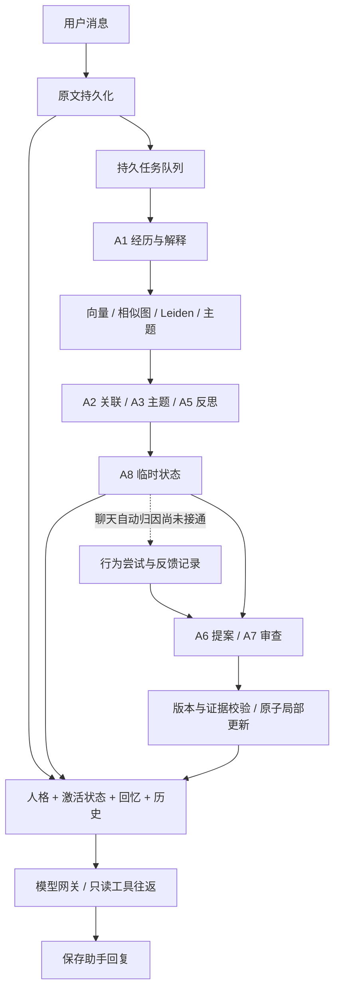

# MYATRI 组件工作方式与代码审查

2026-10-20修复补记：本文审查发现现已有0.1.1离线修复，当前状态与178项完整回归见[持久运行修复](persistence_fixes_2026-10-20.md)。以下保留原审查证据，不能把历史未修状态当作当前结果。

后续实现补记：用户已指定将语义压缩/状态激活改用LLM，现已实现并经116项回归+2次官方合成smoke，见llm_context_upgrade.md。以下为升级前审查基线，旧“仅摘录/仅启发式”描述不代表新生产异步路径；快照/并发索引、行动反馈集成等其他问题仍开放。上下文元数据和失效摘要旁路在本次相关集成中作了修补，不把全部审查项标完成。

2026-10-20；对照规划0.2及当前实际源码。主 Agent 审查集成、模型、人格、上下文、认知与调度；复用 memory 子 Agent 独立审查存储、索引与检索。本轮没有付费请求、密钥读取或生产逻辑修改，所有复现使用临时目录。

**结论：八模块有实际实现，来源/恢复/局部人格提交等已有有效保护，但此前“V1本地完成”的表述过于宽泛。现已复现7项主审查问题/边界，以及2项索引/检索一致性缺陷。行为反馈仍缺普通聊天集成，不能声称完整日常闭环已验收。**

## 用一轮对话串起来

用户说“电影取消了，我有点失落”。前台先把原文落盘，然后读取某一快照的人格、相关临时状态、回忆与聊天历史，调用模型回复。后台另排队整理用户经历、建索引和图、生成主题与反思、提出暂定状态。日后的聊天可以按相关性选中这些状态。只有有来源的外部经历和反例检查支持，A6提案通过A7及程序校验，才会局部修改人格。

箭头表示数据路径，不表示每步都会产生内容；defer、不激活、放弃均为合法结果。当前A5并不保证读取同轮A2/A3的新产物，不应把图中的并列处理误解成严格串行依赖。

## M1 模型与Embedding适配

入口：`src/myatri/providers/gateway.py`、`providers/local_onnx.py`、`credentials.py`。

- 前台及认知调用提交统一ModelRequest；Gateway检查完整工具协议、保守请求预算、独立前后台并发额度，再调用Fixture或DeepSeek。网络/限流等错误可有限重试，结构错误不直接提交。
- 官方适配发送JSON schema作为提示，供应商JSON模式约束语法，本地jsonschema再次约束字段。thinking返回的reasoning_content仅用于协议往返，不变成角色经历。
- 当前普通请求默认thinking=false；此前协议实测通过不等于日常聊天开启thinking。前台并发默认2、后台1；单Conversation仍串行回应。
- key保存在Windows凭据管理器；只有显式live和allow_paid才使用。官方host限制和禁止重定向已经实现。
- Embedding另有可替换provider接口，本地BGE由MemoryIndex调用，不经过聊天API。默认TF-IDF无需下载，BGE是可选本地神经模型；二者不能混称。

已检查：本轮网关针对性回归通过；此前官方13次小规模请求是既有证据，本轮未重做。边界A07：每日额度是每个Gateway的内存计数，启动时从日志恢复；两个同时启动的实例不能原子共享预留。网络超时后供应商是否已计费也不能从本地日志保证。

## M2 经历、版本与来源

入口：`storage/archive.py`、`contracts/__init__.py`、`cognition/experience.py`。

- 原文以raw_message保留。A1从用户原文抽Event，发生日期未知保持null；fictional/quoted等与reported/observed分开。A1验证quote逐字存在，并保存字符区间。情绪与解释另存interpretation，不能改写原始事件。
- 重新提到同一事件可以引用既有事件，只产生新的解释/原文来源，不增加独立事件根。真实语义去重依赖模型判断，不是可证明永不重复。
- Record使用`ID@revision`；body_markdown与payload有内容hash，档案文件与提交清单另有校验。这里实际权威是包含Markdown正文的UTF-8 JSON，不是可随意手改的Markdown目录。
- 提交先写不可变记录文件，再发布manifest，最后重建SQLite/全文检索投影。manifest之前崩溃的孤儿文件不可见；manifest之后投影缺失可重建。跨进程写锁加CAS防止覆盖冲突。
- SQLite档案投影可以重建；runtime.sqlite3中的队列、usage和协议另需备份，不能把两类数据库混为一谈。

独立审查验证原文/来源、档案恢复与CAS；这不自动证明后续索引快照一致，M3/M4存在新发现。hash用于发现内容与已记录校验值不一致，并不是针对能重写整份档案者的签名。

## M3 向量、图、群落与主题

入口：`memory/index.py`、`embeddings.py`、`graph.py`、`clustering.py`、`themes.py`。

- 默认char 1–4 gram TF-IDF描述词面共现；可显式切换固定revision的BGE-small-zh-v1.5量化ONNX、CLS/L2、512维。缓存绑定正文hash、视角、模型版本和向量空间，拒绝混用不同空间。
- “event向量视角”能索引多种业务记录；“记忆图的事件节点”则严格只用Event，不能因视角名称相同而混淆。感受视角来自已有解释字段，缺失时省略并重新归一化可用权重。
- 相似图是kNN候选、阈值和度数约束。supports/contradicts/follows_up等由A2给出有来源的语义假设；相似不等于支持，contradicts不作为正向聚类权重。
- Leiden真实运行多分辨率/递归分区。单次分区不天然重叠，代码另存软主题归属。主题ID按成员重合衔接，材料hash变化会使旧模型摘要失效；算法占位名不等于A3语义命名。
- theme_materials的time_span当前取Record.created_at，即档案记录创建跨度，不能解释成事件实际发生时间跨度；旧事集中导入时尤其不同。
- 目前精确检索与全量重建是基线，没有ANN或局部更新的性能承诺。索引代次先完整落盘再原子换current指针，支持回滚。

确认缺陷M02：原子换指针只保证文件完整，不保证发布顺序。较慢的旧重建可以覆盖先完成的新重建，索引水位倒退；原始档案没有丢，新的向量却可能暂时缺失。需发布时校验水位/代次并避免自动回退。A01：只截主题前8项再筛needs_summary，后方主题可饥饿。

## M4 回忆检索

入口：`retrieval/service.py`。

查询先按日期、参与人及类型过滤，再结合全文、中文词面、向量、主题和有限图扩展，用RRF合并排序。RRF合并的是名次，不是把不同来源分数当同一种概率。反驳材料优先保留；输出RecallBundle包括版本记录、召回原因、路径、反例和局限。

引用原话时要求相应原文一同进入预算；较长派生来源链可以保留指针及省略说明，用read_record精确读取。暂停状态可被回忆，但激活器只选open；已撤回状态默认不作当前候选。人格变化的before/after/replacement也有可搜索文本，支持“为什么变了”的追溯。

确认缺陷M01：旧snapshot过滤了记录，却仍使用当前索引的图；只检查边两端是否可见，没有检查关系记录在旧快照是否存在。两个旧事件之间后来新增的contradicts，能泄入历史回忆的counter_refs。需快照兼容图或回退到该快照可见关系，不能只过滤端点。

检索有效性边界：现有36个合成会话的留出结果，TF-IDF单视角MRR@5=1.000，加入图/主题0.958，多视角0.764；BGE单视角0.958，多视角0.917。不能宣称复杂组合必然更好，也不能从关键词合成样本推导开放域效果。

## M5 人格、临时状态与尝试

入口：`persona/state.py`、`temporary.py`、`activation.py`、`patch.py`。

- 人格是稳定条目表，默认只有P01/P02/P03三条示例；P03“分歧时通常先迁就”是初始设定，不是系统观察用户得出的事实。正式角色卡仍值得用户定稿。
- 临时状态统一承载thought/情感余波/暂定意图/未决问题，持久保留来源、范围、暂定性和生命周期。经验状态需外部事件根；generated_idea引用生成run，不能当外部证据。
- open可被选中，paused背景保留，settled已解决，discarded放弃，consolidated与人格变化原子关联。激活只做注意分配，当前最多4条、文本预算600字节；相关性是启发式，选中不等于表达或尝试。
- 行为接口区分planned/draft/expressed/attempted等；expressed/attempted必须指向实际持久化助手原文并有发生时间。无反馈必须unknown；真实用户反馈需外部Event。撤回后允许补记已有行为的迟到反馈，不复活状态。
- 人格修订需要当前base_revision、旧条目hash、外部事件根、反例检索记录、覆盖来源且绑定确切patch_hash的A7接受。提交persona_change、persona新版本及相关state consolidated为同一原子批次，其余条目保持。人工编辑/恢复另标human_edit/human_restore。

确认集成缺口A05：生产聊天、CLI、认知任务没有调用record_attempt_feedback，普通对话不会自动形成行动与反馈归因；当前测试人工调用接口不能代替接通。建议采用后台只读归因提案，引用确切助手原文/用户Event，不能只因状态激活就写attempted。

待决策：是否所有人格条目允许自动改，还是锁定身份/边界条目；现程序对已存在条目统一适用校验，无不可改条目清单。是否只允许有实际反馈的实践倾向巩固，还是也允许独立经历支持的认识修订；当前不硬性要求attempt_refs非空。

## M6 前台与上下文压缩

入口：`conversation/engine.py`、`context.py`、`budget.py`、`compaction.py`。

前台先落盘用户消息并入队，固定快照后构建：运行规则/当前人格 → 暂定状态 → 回忆 → 摘要与历史。只提供recall/read_record两个本地只读工具，最多4步，工具参数和完整往返都验证。稳定message_id可避免已完成回复重复写入；工具边界持久化协议，重启可以继续。

预算按完整UTF-8请求字节保守估计，先减少回忆，再自动压缩旧聊天；固定内容依然太大时明确报错。当前“压缩”是原文摘录，每条默认前160字符，近期原文和显式preserve保留；不是大模型语义摘要。原文仍在，但未保留的重要细节可能不出现在首屏上下文，要靠再次检索或精确读取。人格或已有引用状态版本变化后旧摘要失效。

确认缺陷A03：注入回忆只投影ref/kind/text/reason，Event.reality_scope、日期及部分状态语义未显式传入。示例fictional事件被检索后上下文没有fictional标记；模型虽可工具读取，主路径仍丢失关键区分，应按类型带出最小必要元数据。

其他边界：单Conversation锁不等于跨进程同一会话锁；同一角色/用户所有raw历史作为一条会话流，没有独立session分支。当前原文摘录保重要信息的能力需进一步设计，不能当语义压缩已完成。

## M7 认知子代理

这是软件内逻辑角色，不是开发时主/子Agent，也不是8个持续各有意识的进程。它们共享网关，按任务提供材料并返回结构化提案。

|角色|实际职责|边界|
|---|---|---|
|A1|从用户原文抽Event/解释、识别旧事件重提|逐字引文校验；真实语义去重依赖模型|
|A2|为候选近邻提出有类型的语义边|相似不是支持；证据必须在输入中|
|A3|给变化主题生成名称/摘要|材料hash不匹配会失效|
|A4|RecallService检索能力|当前是本地算法服务，无独立模型代理|
|A5|比较材料，输出反思与不确定性|反思不增加外部事件根|
|A6|提出局部人格patch或defer|不能直接提交人格|
|A7|只读审阅patch|两个判断一致不证明事实|
|A8|新建/调整/暂停/放弃临时状态|不能直接consolidated；v2严格字段|

统一cognitive_call读取快照材料、加载版本prompt、调用网关；proposal_for记录读版本，Committer统一提交。当前A2/A3与A5是独立排队任务，A5输入主要是cycle给定事件和状态，不保证自动获得刚生成的边/主题。反例检索目前主要复用状态主题查询及contradicts，尚不是充分的专门反证搜索策略。

确认问题A06：cycle通常传所有Event，A2候选虽然限制30个近邻pair，却仍携带全部refs；A5/A6同样缺材料分批/局部预算。28条探针长事件已使A5在请求前BudgetExceeded，provider调用0次。预算保护是正确的，材料规划不足会让后台持续无法处理；应按新增材料、邻域、未决状态与反例预算选材，而不是加大额度掩盖。

真实验证范围：此前A1/A2/A3/A5有小样本真实请求；A8初测字段错误被拒，v2恢复以defer通过；A6/A7真实人格判断、长期连续性未验。不能强制模型输出变化以凑成功。

## M8 持久运行、调度与提交

入口：`runtime/jobs.py`、`worker.py`、`scheduler.py`、`commit.py`及`app.py`。

JobSpec以角色、输入版本、prompt版本、目标版本、payload计算幂等键。SQLite队列有优先级、租约、心跳、尝试次数和失败/延期。Worker先保存模型结果，再统一提交；提交中断重启能重用结果，避免已经保存的模型输出再次付费生成。CAS冲突拒绝覆盖，但当前不会自动重新选材生成，需要新材料/新版本任务。

调度默认上海时区、3小时周期、02:00夜间、空闲90分钟；只是工程配置，不是用户作息。当前每个新消息索引后也触发认知cycle，并非仅低频运行。离线fixture语义任务通常defer；live后台可能每轮产生多次请求。

确认问题A02：到期review的幂等键只含状态版本；同一状态先defer，之后新证据到了，专门到期复审任务仍复用旧成功job。普通新事件cycle仍可能处理该状态，所以不是完全永不复审；但复审任务键和材料选择不完整。空闲持续成立时每秒重写last_scheduled，需边沿/水位记录。

确认缺陷A04：TemporaryEntry.review_at是任意字符串，可接受无时区日期；后台直接datetime.fromisoformat与aware UTC比较会TypeError并退出调度循环。应统一验证带时区时间并在入口给清晰错误，或由产品约定将纯日期转换为本地何时。

## 复现与修改建议

|ID|影响及优先级|建议修改|关联任务|
|---|---|---|---|
|M01|高：历史回忆包含未来关系|图关系/主题均按快照验证，不能只过滤端点|T09|
|M02|高：并发索引自动倒退|发布时做代次/水位CAS；显式回滚单独操作|T07/T08|
|A03|高：上下文丢虚构/事实等标记|按记录类型保留最小业务元数据与来源提示|T10/T11|
|A04|高：合法契约输入使后台退出|时间字段规范化、aware校验、错误隔离|T02/T14|
|A05|高：日常行为反馈闭环缺口|接通持久化行动/后续Event的有来源归因提案|T12|
|A06|中：材料增多后台被预算永久阻挡|增量/邻域选材、分批、水位与反例保留|T12/T13|
|A01|中：主题待办饥饿|先筛选再限量，并记录公平排程/续批|T08/T12|
|A02|中：复审依据与触发语义不全|绑定新证据水位与状态版本；空闲按边沿触发|T14|
|A07|中：多实例超出配置日额度|数据库事务共享预留，或显式限制单实例|T04|

建议先修M01/M02/A03/A04及A01，再补A05/A06/A02/A07；不改变“时间与次数不能直接成为人格依据”的规划原则。针对产品语义的选择：角色卡及不可自动改条目、行为归因自动化程度、到期复审规则、默认向量后端、压缩保留要求。无需为修正上述一致性缺陷更换整套架构。

本轮命令与结果：

- `.venv/Scripts/python.exe scripts/audit_components.py`：7项观察均复现；结果`component_review.json`。模拟供应商和控制主题输入仅用于接口/调度探针，不声称模型/聚类质量。
- `.venv/Scripts/python.exe -m pytest tests/test_gateway.py tests/test_context.py tests/test_persona_lifecycle.py tests/test_jobs.py tests/test_protocol_recovery.py -q --junitxml=reports/component_regression.xml`：19 passed，12.14秒。验证已有边界，不涵盖新缺陷修复。
- `.venv/Scripts/python.exe -m pytest tests/audit_memory_consistency.py -q -rx`：2 xfailed（strict，5.88秒），直接调用亦捕获实际断言失败。详情`audit_memory_2026-10-20.json`；预期失败不是已修复，不计成功验收。
- memory子 Agent另对来源/隔离/投影恢复、跨进程CAS、3个崩溃点、真实TF-IDF/Leiden与回滚作定向检查：8 passed，4.15秒；完整命令在独立审查JSON。合计本轮正常定向检查27 passed。

已有80 passed是上轮测试基线，不是本轮“代码无问题”的证明。现有dist包未变，仍包含本轮发现的问题。未进行长期语义/真实网络故障/真实账单验证，没有真实消息发送或外部部署。
